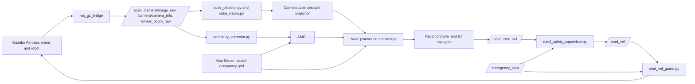

# ROS 2 architecture

The workspace has three `ament_cmake` packages: `competition_robot_description` (Xacro model), `competition_simulation` (Gazebo SDF world), and `competition_bringup` (launch, configuration, Python nodes, tools and tests). `competition.launch.py` starts Fortress, spawns the model, runs `robot_state_publisher`, `ros_gz_bridge` instances, `odometry_corrector.py`, `joint_state_rate_limiter.py` and `cmd_vel_guard.py`. `competition_mapping.launch.py` adds SLAM Toolbox. `competition_nav2.launch.py` adds the saved-map navigation stack, detector, track diagnostics and safety supervisor.

## Data and responsibilities

| Component | Inputs | Outputs / role |
| --- | --- | --- |
| Gazebo bridges | Gazebo camera, LiDAR, wheel odometry, clock and joints | ROS `/camera/image_raw`, `/camera/camera_info`, `/scan`, `/wheel_odom_raw`, `/clock`, joint states |
| `odometry_corrector.py` | `/wheel_odom_raw` | `/odom` and odometry frame |
| `robot_state_publisher` | Xacro robot description and joint states | Body/sensor transforms |
| SLAM Toolbox (mapping mode) | `/scan`, odometry, TF | Online occupancy map and `map → odom` |
| Map Server + `initialize_amcl_pose.py` + AMCL (navigation mode) | Saved map, scan, odometry, initial-pose service | `/map`, `/amcl_pose`, `map → odom` |
| `cube_detector.py` / `cube_tracks.py` | RGB image, camera info, TF | Colored cube detections, status, markers and tracked positions |
| `nav2_safety_supervisor.py` | Plan, scan, odometry, AMCL, cube status, emergency stop and Nav2 commands | Camera cube obstacles, safety status and guarded `/cmd_vel` |
| `cmd_vel_guard.py` | `/cmd_vel`, emergency stop | Timeout and speed-limited Gazebo drive command |
| Nav2 planner/controller/BT navigator | Map, costmaps, pose, goal | `/compute_path_to_pose`, `/navigate_to_pose`, `/plan`, `/nav2_cmd_vel` |

Navigation uses the tree `map → odom → base_footprint → base_link`. AMCL estimates the map-to-odom correction using the saved map; wheel odometry supplies odom-to-base_footprint; the fixed robot model supplies base_footprint-to-base_link and sensor frames. In mapping mode SLAM Toolbox supplies map-to-odom instead. Do not run mapping and saved-map Nav2 modes together. TF stamps matter when converting camera observations to map/odom; stale detections are not fresh obstacles.

The Nav2 global and local costmaps use the same six-vertex footprint including wheels and front pusher, a static layer, obstacle inputs and camera-based cube projection. `footprint_clearance.py` separately checks oriented swept geometry, occupied/unknown map cells, live lethal costmap cells and physical cube boxes. It is a validation tool; Nav2's `ComputePathToPose` success is not a clearance certificate. `enable_motion:=false` keeps the movement path disabled for diagnostics.

See [Phase 5G](../reports/phase5g_cube_tracking_costmap_validation.md) and [Phase 5H](../reports/phase5h_narrow_passage_validation.md) for measured behavior and limits.
